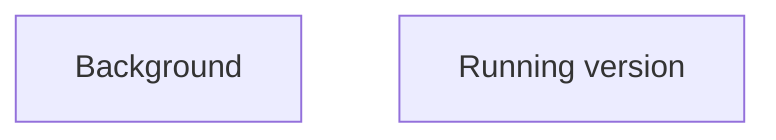

## 1. Stack
- Language: C++ (`Background/game.cpp`; `Running version/desert_scene.cpp`, `player.cpp`, `player.h`)
- Graphics: OpenGL + GLUT/freeglut (per `Background/README.md`, `Running version/README.md`)
- Build: `Background/Makefile` (GNU Make, g++, `-std=c++11`); `Running version/` has no build script — built via direct `g++` invocation per its README
- No package manifest at repo root (no package.json / go.mod / pyproject.toml / Cargo.toml)
- Compiled artifacts committed directly in both directories (object file + prebuilt executables)

## 2. Directory map
| Path | What lives there |
|---|---|
| README.md | Root readme (title only, no content) |
| Background/ | Prototype/earlier single-file implementation |
| Background/Makefile | Build rules: targets `all`, `run`, `debug`, `clean`, `rebuild`, `help`, `info`; platform-detects Linux/Darwin/Windows for GLUT link flags |
| Background/README.md | Background-specific readme |
| Background/code.md | Markdown notes |
| Background/game.cpp | C++ source, single file |
| Background/game.o | Compiled object file |
| Background/game_macos | Compiled macOS executable |
| Background/WhatsApp Image 2026-08-07 at 21.22.43.jpeg | Image asset |
| Running version/ | Current/active implementation |
| Running version/README.md | Running-version-specific readme |
| Running version/desert_scene.cpp | C++ source — builds the scene, animation loop, sky/clouds/cacti/player calls |
| Running version/player.cpp | C++ source — draws player, jump/run animation |
| Running version/player.h | C++ header — public player function declarations |
| Running version/desert_scene | Compiled executable |
| Running version/game | Compiled executable |
| Running version/player | Compiled executable |
| Running version/How-the-Desert-Runner-Works.pdf | Design/reference document |

## 3. Diagram

No import/call relationship observed between the two directories (they are independent, self-contained implementations; no shared build config found at repo root).

## 4. Component index
- [[Background]]
- [[Running version]]

## 5. Entry points
- `Background/`: `main()` in `Background/game.cpp` (GLUT app); build with `make` (from `Background/Makefile`), run with `make run` or the produced `game_macos` / `game_linux` / `game_windows.exe`
- `Running version/`: entry point is `main()` in `Running version/desert_scene.cpp` (per its README); build command per its README: `g++ desert_scene.cpp player.cpp -o game -framework OpenGL -framework GLUT`, run with `./game`
- Prod (prebuilt binaries present in repo):
  - `Background/game_macos`
  - `Running version/game`
  - `Running version/desert_scene`
  - `Running version/player`

## 6. Conventions
- Two parallel top-level implementations, each self-contained with its own README.md
- Each directory ships both source (.cpp/.h) and compiled binaries side by side
- Directory name `Running version` contains a literal space
- `Running version/` splits player logic into its own `.cpp`/`.h` pair (`player.cpp`/`player.h`) separate from the scene driver (`desert_scene.cpp`); `Background/` keeps everything in one file (`game.cpp`)
- `Background/Makefile` auto-detects OS (`Darwin`/`Linux`/`Windows_NT`) to choose GLUT link flags and executable name

## 7. Where things go
- Modify current game logic: edit files under `Running version/` (`desert_scene.cpp`, `player.cpp`, `player.h`)
- Add a new gameplay module to current version: add a paired `.cpp`/`.h` in `Running version/`, following the `player.cpp`/`player.h` split
- Modify the prototype: edit `Background/game.cpp`, rebuild via `Background/Makefile` (`make`)
- Update project overview: `README.md` (root)
- Update design/reference notes: `Running version/How-the-Desert-Runner-Works.pdf`, `Background/code.md`
