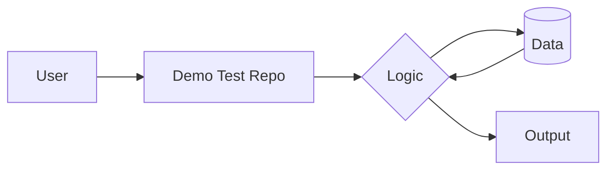

# Demo_Test_Repo
Test for the player jump logic (macOS):

## Architecture / How it Works

    g++ tests/player_test.cpp "Running version/player.cpp" -o tests/player_test.out -framework OpenGL -framework GLUT -Wno-deprecated-declarations && ./tests/player_test.out
